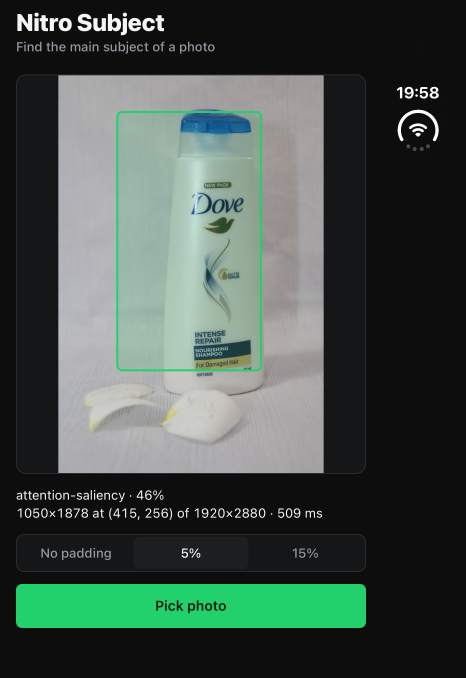
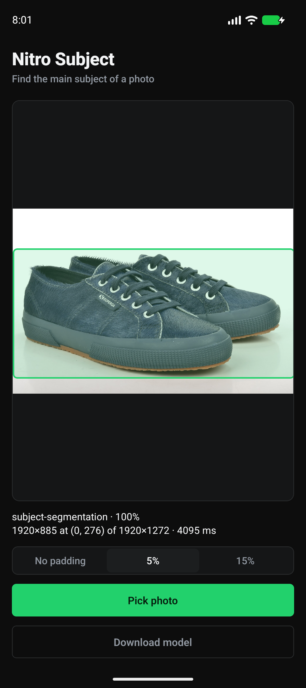

<h1 align="center">Nitro Subject</h1>

<p align="center">
  <strong>Find the main subject of a photo and get its bounding box — with the platform's own on-device vision</strong>
</p>

<p align="center">
  <a href="https://www.npmjs.com/package/@salve-software/react-native-nitro-subject"></a>
  
  
  
  
</p>

<p align="center">
  
  &nbsp;&nbsp;
  
</p>

---

Nitro Subject takes a photo and tells you where its main subject is — `{ x, y, width, height }` in pixels of the image as the user sees it — so you can auto-crop product photos, center thumbnails or frame a scan. It runs entirely on device, off the JS thread, using only what each platform already ships: **Apple Vision** on iOS and **ML Kit Subject Segmentation through Google Play services** on Android.

## Why

The usual answer for this is Google ML Kit object detection. On iOS, ML Kit is distributed as legacy frameworks with no arm64 simulator slice, so adding it makes CocoaPods exclude `arm64` for the simulator — and the app no longer runs on any iPhone simulator on Apple Silicon, with no Rosetta destination left in recent Xcode versions.

Nitro Subject vendors **no binaries at all**: Vision is part of iOS, and on Android the model is an optional Google Play services module the system downloads and updates. It builds for every architecture, simulators included, and adds nothing to your APK besides a thin client.

## Features

- **One call** — `Subject.detect({ uri })` resolves the subject box, or `null` when there is none.
- **EXIF-aware** — coordinates refer to the upright image, ready to hand to any cropper.
- **Best engine per platform** — iOS 17+ foreground instance mask, saliency fallbacks on older iOS; ML Kit subject segmentation on Android.
- **Padding and minimum size** — applied and clamped to the image for you.
- **Never blocks on downloads** — if the Android model isn't on the device yet, `detect` resolves `null` and schedules the download; `Subject.prepare()` downloads it ahead of time.
- **Off the JS thread** — images are downscaled for analysis and the box is mapped back to full resolution.

## Architecture

```text
┌──────────────────────────────┐      JSI (Nitro Modules)      ┌──────────────────────────────────────────────┐
│     TypeScript (DX layer)    │ ────────────────────────────▶ │          HybridSubjectDetector               │
│                              │                               │                                              │
│  Subject.detect / prepare    │                               │  iOS — SubjectLocator                        │
│  props validation            │                               │    ImageIO: upright 1024 px thumbnail        │
│  padding, clamp to image,    │ ◀──────────────────────────── │    SubjectEngineChain                        │
│  whole pixels, minAreaRatio  │    box in upright pixels      │      ForegroundMaskEngine (iOS 17+)          │
└──────────────────────────────┘                               │      SaliencyEngine (objectness, attention)  │
                                                               │                                              │
                                                               │  Android — SubjectLocator                     │
                                                               │    UprightImageLoader (EXIF → Matrix)        │
                                                               │    SubjectSegmenterEngine (ML Kit, GMS)      │
                                                               │    SubjectModelInstaller (ModuleInstall)     │
                                                               └──────────────────────────────────────────────┘
```

The native side only locates the subject and maps it to full-resolution upright pixels; everything that is policy (padding, rounding, minimum area) lives in TypeScript, so it behaves identically on both platforms and is unit-tested once.

## Installation

### Requirements

| | Minimum |
|---|---|
| React Native | 0.78 (New Architecture) |
| react-native-nitro-modules | 0.37 |
| iOS | 15.1 — foreground mask on 17+ |
| Android | API 24 with Google Play services |

> **New Architecture only.** The Old Architecture is not supported.

### Install the package

```sh
yarn add @salve-software/react-native-nitro-subject react-native-nitro-modules
```

```sh
npm install @salve-software/react-native-nitro-subject react-native-nitro-modules
```

Then `cd ios && pod install`. With Expo, use a [development build](https://docs.expo.dev/develop/development-builds/introduction/) (`npx expo prebuild`); no config plugin is needed.

### Android: download the model at install time (optional)

By default Google Play services fetches the model the first time it's needed. To have it downloaded when the app is installed from the Play Store, declare it in your app's `AndroidManifest.xml`, comma-separated with any other ML Kit module you already list:

```xml
<application>
  <meta-data
    android:name="com.google.mlkit.vision.DEPENDENCIES"
    android:value="subject_segment" />
</application>
```

## Usage

### 1. Detect

```ts
import { Subject } from '@salve-software/react-native-nitro-subject';

const frame = await Subject.detect({ uri: photo.uri, padding: 0.05 });

if (frame) {
  frame.x, frame.y, frame.width, frame.height; // whole pixels of the upright image
  frame.imageWidth, frame.imageHeight; // size of the upright image
  frame.confidence; // 0–1, when the engine reports one
  frame.source; // which engine answered
}
```

### 2. Crop

The frame is in the coordinate space image croppers use. With `expo-image-manipulator`:

```ts
import { ImageManipulator, SaveFormat } from 'expo-image-manipulator';

const frame = await Subject.detect({ uri, padding: 0.05, minAreaRatio: 0.02 });

if (frame) {
  const context = ImageManipulator.manipulate(uri);
  context.crop({ originX: frame.x, originY: frame.y, width: frame.width, height: frame.height });
  const image = await context.renderAsync();
  const cropped = await image.saveAsync({ format: SaveFormat.JPEG, compress: 0.9 });
}
```

More recipes in [docs/cropping.md](./docs/cropping.md).

### 3. Warm up the Android model (optional)

```ts
// e.g. when the user opens the screen that takes the photo
const ready = await Subject.prepare({ timeoutMs: 30_000 });
```

## API

### `Subject.detect(props)` → `Promise<ISubjectFrame | null>`

| Prop | Type | Default | Description |
|---|---|---|---|
| `uri` | `string` | — | `file://` URI or absolute path. Android also accepts `content://`. |
| `padding` | `number` | `0` | Margin on each side as a fraction of the box size (`0.1` = 10%). Clamped to the image. |
| `minAreaRatio` | `number` | `0` | Boxes covering less than this fraction (0–1) of the image resolve `null`. |

Throws synchronously for invalid props (empty `uri`, negative `padding`, `minAreaRatio` outside 0–1). Rejects when the image can't be read or the uri scheme isn't supported.

### `ISubjectFrame`

| Field | Type | Description |
|---|---|---|
| `x`, `y` | `number` | Top-left corner, whole pixels of the upright image |
| `width`, `height` | `number` | Box size, whole pixels |
| `imageWidth`, `imageHeight` | `number` | Size of the upright (EXIF-corrected) image |
| `confidence` | `number \| undefined` | 0–1 score, when the engine reports one |
| `source` | `SubjectSource` | `'foreground-mask' \| 'objectness-saliency' \| 'attention-saliency' \| 'subject-segmentation'` |

### `Subject.prepare(props?)` → `Promise<boolean>`

| Prop | Type | Default | Description |
|---|---|---|---|
| `timeoutMs` | `number` | `30000` | How long to wait for the Android download. |

Android: checks for the model and downloads it through Google Play services if needed; `true` once it's ready, `false` on timeout, failure or no Play services. iOS: `true` right away.

## Platform behavior

| Platform | Engine | Box |
|---|---|---|
| iOS 17+ | `VNGenerateForegroundInstanceMaskRequest` | Union of every foreground instance |
| iOS < 17, or fallback | `VNGenerateObjectnessBasedSaliencyImageRequest` | Most confident salient object |
| Last fallback | `VNGenerateAttentionBasedSaliencyImageRequest` | Where a person would look first — almost always answers; check `source` to ignore it |
| Android | ML Kit Subject Segmentation (Play services) | Foreground confidence > 0.5; `confidence` is the mean inside it |

> **iOS Simulator.** The simulator has no Neural Engine: the foreground mask and objectness models don't run there even on the CPU, so results come from attention saliency. Everything builds and runs end-to-end, but judge crop quality on a device.

Details in [docs/platform-behavior.md](./docs/platform-behavior.md).

## Example app

`example/` picks a photo, outlines the subject and lets you switch padding; on Android it can also download the model.

```sh
yarn
yarn example pod      # iOS only
yarn example ios      # or: yarn example android
```

## Testing

```sh
yarn test                 # TypeScript (Jest)
yarn test:native:ios      # Swift core + real Vision on the host Mac (swift test)
yarn test:native:android  # Kotlin core (JUnit)
```

## Contributing

Pull requests are welcome. For major changes, please open an issue first to discuss what you'd like to change. Commits follow [Conventional Commits](https://www.conventionalcommits.org/).

## License

MIT © [Salve Software](https://github.com/Salve-Software)
