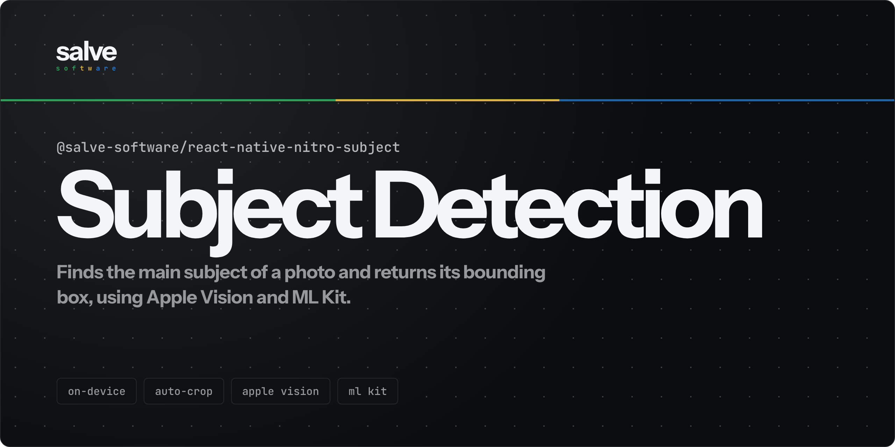

<p align="center">
  
</p>

<p align="center">
  
  
  
  
</p>

Finds the main subject in a photo and returns its bounding box. Useful for auto-cropping product photos.

It uses Apple Vision on iOS and ML Kit Subject Segmentation (through Google Play services) on Android. No binaries are bundled, so the iOS pod also builds for the arm64 simulator.

## Requirements

- React Native 0.78+ with the New Architecture
- react-native-nitro-modules 0.37+
- iOS 15.1+ (iOS 17+ for the best results)
- Android API 24+ with Google Play services

## Installation

```sh
yarn add @salve-software/react-native-nitro-subject react-native-nitro-modules
cd ios && pod install
```

On Expo, use a development build. No config plugin is needed.

## Usage

```ts
import { Subject } from '@salve-software/react-native-nitro-subject';

const frame = await Subject.detect({ uri: photo.uri, padding: 0.05 });

if (frame) {
  console.log(frame.x, frame.y, frame.width, frame.height);
}
```

The box is in pixels of the image as it is displayed, with the EXIF orientation already applied. You can pass it straight to a cropper:

```ts
import { ImageManipulator } from 'expo-image-manipulator';

const context = ImageManipulator.manipulate(uri);
context.crop({ originX: frame.x, originY: frame.y, width: frame.width, height: frame.height });
const cropped = await (await context.renderAsync()).saveAsync();
```

See [docs/cropping.md](./docs/cropping.md) for other croppers.

### Android model

On Android the model is downloaded by Google Play services. If it is not on the device yet, `detect` returns `null` and the download starts in the background. To download it ahead of time:

```ts
await Subject.prepare();
```

Or have it downloaded when the app is installed from the Play Store, by adding this to `AndroidManifest.xml`:

```xml
<meta-data
  android:name="com.google.mlkit.vision.DEPENDENCIES"
  android:value="subject_segment" />
```

## API

### `Subject.detect(options)`

| Option | Type | Default | |
|---|---|---|---|
| `uri` | `string` | | `file://` uri or absolute path. Android also accepts `content://`. |
| `padding` | `number` | `0` | Margin added on each side, as a fraction of the box size. |
| `minAreaRatio` | `number` | `0` | Boxes smaller than this fraction of the image return `null`. |

Returns `Promise<ISubjectFrame | null>`:

| Field | Type | |
|---|---|---|
| `x`, `y`, `width`, `height` | `number` | The box, in pixels |
| `imageWidth`, `imageHeight` | `number` | Size of the image |
| `confidence` | `number?` | Between 0 and 1, when available |
| `source` | `string` | Which engine found the subject |

Invalid options throw. A file that can't be read rejects the promise.

### `Subject.prepare(options?)`

Downloads the Android model and waits for it (`timeoutMs`, default 30000). Returns `true` when the model is ready. On iOS it returns `true` right away.

## How it works

On iOS 17+ it uses `VNGenerateForegroundInstanceMaskRequest`. On older versions, or if that fails, it falls back to objectness saliency and then attention saliency. On Android it uses the foreground mask from ML Kit Subject Segmentation.

The iOS Simulator can't run the foreground mask model, so there you only get attention saliency results, which are less precise. Test crop quality on a real device.

More details in [docs/platform-behavior.md](./docs/platform-behavior.md).

## Development

```sh
yarn
yarn test                 # JS tests
yarn test:native:ios      # Swift tests
yarn test:native:android  # Kotlin tests
yarn example ios          # or android
```

Releases are automated, see [docs/releasing.md](./docs/releasing.md).

## License

MIT
